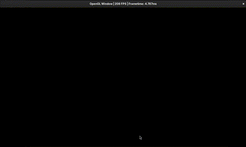

Fluid Simulation
---

A real-time, GPU-accelerated 2D fluid simulation rendered with OpenGL compute
shaders. The simulation runs in a fixed 1280 × 720 window.



## Features

- Semi-Lagrangian advection of the velocity and dye fields.
- Incompressible-flow projection using divergence calculation, iterative
  Jacobi pressure solving, and pressure-gradient subtraction.
- Interactive mouse input: hold and drag the left mouse button to inject bright
  blue dye and apply force to the fluid.
- GPU compute-shader simulation and OpenGL rendering.
- Frame rate and frame time displayed in the window title.
- OpenGL debug output enabled in non-release builds.

## Libraries and tools

- C++26
- CMake 3.10 or newer
- OpenGL 4.6-capable graphics hardware and drivers
- GLEW for OpenGL function loading
- GLFW for window creation and input
- GLM for vector math

The current CMake target also passes `-freflection` to the C++ compiler. Use a
compiler that supports both C++26 and this flag.

## Build and run

On Debian/Ubuntu, install the build tools and development libraries:

```sh
sudo apt update
sudo apt install build-essential clang cmake \
  libgl-dev libglew-dev libglfw3-dev libglm-dev
```
On Arch, install the build tools and development libraries:

```sh
sudo pamcan -Syu glfw glew glm
```

Configure and build from the repository root:

```sh
cmake -S . -B build
cmake --build build --parallel
```

Run the application from the repository root:

```sh
./build/fluid-main
```

Running from the repository root is necessary because the application loads its
shader files using paths relative to the current working directory. Close the
window to exit.

## Controls

- **Left mouse button + drag** — inject dye and stir the fluid.

## Project layout

```text
include/          OpenGL resource and utility headers
src/              Application and OpenGL resource-management code
shaders/           Rendering and fluid-simulation GLSL shaders
  fluid/           Compute shaders for advection, splatting, and projection
```

## License

This project is distributed under the MIT License; see [LICENSE.md](LICENSE.md).
